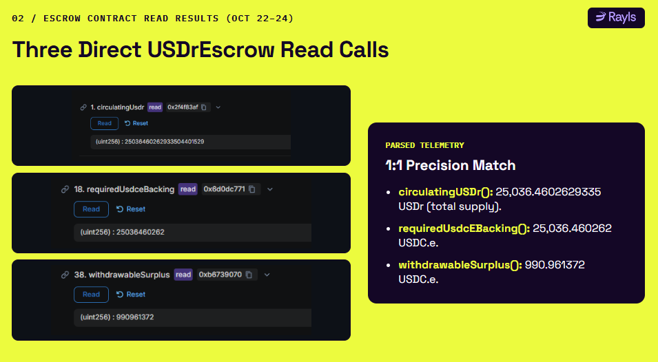
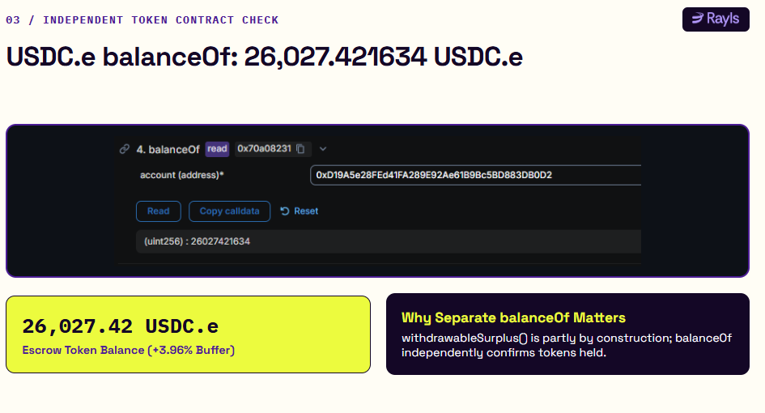

# What Backs USDr on Rayls? An Onchain Check of Its Stablecoin Gas Token

  
**Research period:** October 22–24, 2026  
**Category:** On-chain Research · Stablecoins · Rayls

## Overview

I inspected the Rayls USDr escrow, queried the USDC.e token balance directly, and investigated how much of the backing claim I could independently verify.

On Rayls, transaction fees are paid in USDr, a dollar-pegged token designed to make gas costs more predictable.

According to the [Rayls Transparency Portal](https://transparency.rayls.com/), USDr is backed 1:1 by USDC.e. The gas-token interface also displays a rate of 1 USDr to 1 USDC and describes a route for redeeming USDr back to USDC on Ethereum.

Those are useful starting points. But I wanted to investigate a more specific question:

**Can the on-chain contracts independently support the claim that USDr is backed by USDC.e, and how much of the complete backing arrangement can be verified from public data?**

I focused on read-only contract queries and explorer data. I did not connect a wallet, send transactions, or attempt redemption.

## 1. Starting with the published claim

The Rayls Transparency Portal describes USDr as a USD-backed gas token, backed 1:1 by USDC.e for predictable transaction fees.

During my checks, the portal displayed:

- **USDr market capitalization:** approximately $25,036
- **Holders:** 1,243

The USDr token explorer showed a maximum total supply of 25,036.46 USDr, 18 decimals, and 10,577 transfers.

These figures provide context about the token's reported scale and activity. However, a dashboard, holder count, or supply figure cannot independently establish that the backing assets are present.

For that, I moved to the contracts.

**Sources:** [Rayls Transparency Portal](https://transparency.rayls.com/) · [USDr token explorer](https://explorer.rayls.com/token/0x0000000000000000000000000000000000000400)

## 2. Understanding the intended backing path

The documented arrangement involves USDC on Ethereum, bridged USDC.e on Rayls, and an escrow contract holding USDC.e to support USDr.

Conceptually, the path looks like this:

```text
Ethereum USDC
      |
      v
Bridge infrastructure
      |
      v
Rayls USDC.e
      |
      v
USDr escrow
```

The escrow's role is important because the backing claim can be tested against two measurable quantities:

1. How much USDr exists?
2. How much USDC.e does the escrow hold, and how much is required to back the reported supply?

There is an important distinction here: confirming the Rayls-side balance is not the same as verifying the complete cross-chain backing path. The Ethereum-side pool and its accounting must also be examined.

**Source:** [Rayls Public Chain Tokenomics](https://docs.rayls.com/docs/public-chain-tokenomics)

## 3. Reading the USDr escrow contract

I inspected the Rayls escrow at:

[`0xD19A5e28FEd41FA289E92Ae61B9Bc5BD883DB0D2`](https://explorer.rayls.com/address/0xD19A5e28FEd41FA289E92Ae61B9Bc5BD883DB0D2)

The Rayls explorer identifies the address as a proxy, with an implementation named `USDrEscrow`.

I used the explorer's read interface to query three functions. These are read-only checks, not transactions.

The results below were observed during my October 22–24, 2026 checks.

| Contract query | Observed result |
|---|---:|
| `circulatingUSDr()` | 25,036.4602629335 USDr |
| `requiredUsdcEBacking()` | 25,036.460262 USDC.e |
| `withdrawableSurplus()` | 990.961372 USDC.e |




One detail matters: despite its name, the verified source for `circulatingUSDr()` shows that it returns `usdr.totalSupply()`. I therefore interpret it as a total-supply reading, not an independently calculated circulating-supply figure.

The reported USDr supply and required USDC.e backing align to the displayed precision.

That is a useful first result. But I also wanted to check the underlying token balance directly rather than relying only on values calculated by the escrow.

**Source:** [Rayls USDr escrow explorer](https://explorer.rayls.com/address/0xD19A5e28FEd41FA289E92Ae61B9Bc5BD883DB0D2)

## 4. Checking the USDC.e balance independently

I queried `balanceOf(escrow)` on the USDC.e token contract, using the escrow address as the account.

The returned balance was:

**26,027.421634 USDC.e**

The token uses six decimals, so the raw integer returned by the contract was `26027421634`.




The escrow reported required backing of 25,036.460262 USDC.e. Comparing the two figures gives:

```text
26,027.421634 - 25,036.460262
= 990.961372 USDC.e
```

The escrow therefore held 990.961372 USDC.e above its reported required backing at the time of the check.

That difference is approximately 3.96% of the required backing amount.

This direct token-balance query is particularly useful because it independently checks the tokens held at the escrow address. It does not rely solely on the escrow's `withdrawableSurplus()` calculation, which is defined in terms of liquid USDC.e minus required backing.

However, I would not describe this as proof of system-wide overcollateralization. It is a snapshot of the balance at one contract on Rayls, not a complete accounting of all assets and liabilities across the bridge.

**Source:** [USDC.e token explorer](https://explorer.rayls.com/token/0x9001dbe4D68d36ab87923A2a9Dfb0c745fd25001)

## 5. What about redemption?

The Rayls gas-token interface displays a rate of 1 USDr to 1 USDC and describes redemption back to USDC on Ethereum.

That documents the published route and quoted rate. It does not establish that a redemption will always succeed, that liquidity will always be available, or that every cross-chain component is operating correctly.

I did not connect a wallet or submit a redemption transaction as part of this investigation.

So I can report what the interface displays, but I cannot claim to have independently tested the full redemption process.

This distinction is important for any stablecoin: a displayed exchange rate and a functioning redemption mechanism are related, but they are not the same thing.

## 6. The unresolved Ethereum-side question

The biggest gap in my investigation is the Ethereum-side backing pool.

A public Ethereum pool address has been identified:

[`0xc026395860Db2d07ee33e05fE50ed7bD583189C7`](https://etherscan.io/address/0xc026395860Db2d07ee33e05fE50ed7bD583189C7)

But identifying a pool is not enough. The pool serves multiple networks, so its entire USDC balance cannot automatically be attributed to Rayls.

To establish the complete backing picture, further work would be needed to:

1. Verify the bridge configuration.
2. Trace relevant Ethereum-to-Rayls transactions.
3. Determine how the shared pool accounts for Rayls' share of the assets and liabilities.

I did not independently establish that Rayls-specific allocation in this check.

That means I cannot use the Rayls-side escrow balance alone to claim that the complete cross-chain backing arrangement has been fully verified.

**Source:** [Ethereum pool on Etherscan](https://etherscan.io/address/0xc026395860Db2d07ee33e05fE50ed7bD583189C7)

## 7. What I could—and could not—verify

After checking the publicly available contract data, I would separate the findings into two groups.

### What my checks support

- The Rayls explorer identifies the escrow proxy and its `USDrEscrow` implementation.
- The escrow reports USDr total supply of approximately 25,036.46 USDr.
- The escrow reports required backing of approximately 25,036.46 USDC.e.
- A direct token query returned 26,027.421634 USDC.e held by the escrow.
- At the time checked, the escrow balance exceeded required backing by 990.961372 USDC.e.

### What remains unverified in my investigation

- The amount of USDC in the shared Ethereum pool attributable specifically to Rayls.
- The complete cross-chain accounting between Ethereum USDC and Rayls USDC.e.
- Successful real-world redemption from USDr back to Ethereum USDC.
- A system-wide backing guarantee or formal audit conclusion.

There is also a governance question worth examining separately. The escrow's `minterBurner()` query returned an address, and the verified source includes an admin-restricted function that can update that address.

I did not establish the full admin-role setup or who controls the returned address, so I draw no conclusion about the complete minting-authority arrangement.

## Conclusion: A useful on-chain check, not the whole story

The Rayls-side results were consistent with the stated backing mechanism at the time I checked them.

The escrow reported required backing in line with USDr total supply to the displayed precision, and a direct USDC.e token query showed a balance above that requirement.

That is meaningful evidence. It is more informative than relying on a dashboard claim alone.

But the conclusion has a boundary: I did not independently establish the Rayls-specific share of the Ethereum-side pool, trace the entire cross-chain accounting path, or test redemption.

My conclusion is therefore deliberately narrow:

**The Rayls-side escrow balance covered its reported required backing during my checks. The complete Ethereum-to-Rayls backing arrangement remains only partially verified by this investigation.**

For stablecoins and gas tokens, that distinction matters. A credible investigation should show not only the numbers that line up, but also the evidence that is still missing.

## Methodology and limitations

This was a point-in-time, read-only examination of public explorer data and contract interfaces conducted on October 22–24, 2026.

The investigation did not involve wallet connections, transactions, or redemption attempts. It was not a formal audit, proof of solvency, or test of redemption functionality.

The findings represent the contract values and explorer information observed during the checks. They should not be treated as a guarantee of current balances or as proof of the complete cross-chain backing arrangement.

## Sources and links

1. **Rayls documentation — Public Chain Tokenomics:** https://docs.rayls.com/docs/public-chain-tokenomics
2. **Rayls Transparency Portal:** https://transparency.rayls.com/
3. **USDr token explorer:** https://explorer.rayls.com/token/0x0000000000000000000000000000000000000400
4. **USDr escrow explorer:** https://explorer.rayls.com/address/0xD19A5e28FEd41FA289E92Ae61B9Bc5BD883DB0D2
5. **USDC.e token explorer:** https://explorer.rayls.com/token/0x9001dbe4D68d36ab87923A2a9Dfb0c745fd25001
6. **Ethereum pool on Etherscan:** https://etherscan.io/address/0xc026395860Db2d07ee33e05fE50ed7bD583189C7

---

*Research by Anazoro. This article documents an exploratory investigation of publicly available on-chain data. It is not financial advice, a formal audit, or a guarantee of USDr's backing or redemption.*
